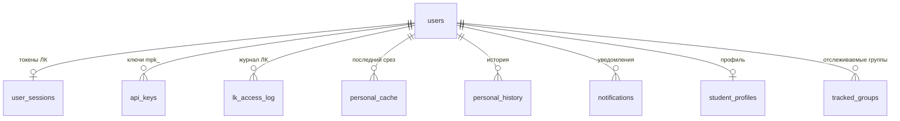

# Схема базы данных

PostgreSQL (ТИО-001), схема ведётся миграциями Alembic (ТИО-002) в `alembic/versions/`, модели —
`src/mospolytech_mcp/db/models.py`. Тест `tests/test_migrations.py` проверяет, что миграции накатываются
с нуля, полностью откатываются и совпадают с моделями. Снимок всей схемы — `db/schema/schema.sql`
(обновляется `scripts/dump_schema.sh`, правила — в `db/schema/README.md`).

## Миграции

| Ревизия | Что добавляет |
|---|---|
| `d3ae49746cfb` | `groups_cache` |
| `5b1c7e2a9f40` | `tracked_groups` |
| `b1747cf96ce4` | `users`, `user_sessions`, `api_keys`, `lk_access_log` |
| `2168974c74e6` | `schedule_cache`, `teacher_lessons`, `service_state` |
| `adcdc720afa3` | `personal_cache`, `personal_history`, `notifications` |
| `e7b2f4c81a90` | `student_profiles` (заполняется из уже полученных профилей) |
| `b8a323584ccb` | `tracked_groups.user_id` с внешним ключом на `users` (данные переносятся по логину) |
| `c3d9f2a71e05` | индекс `lk_access_log (created_at)` |

Миграции пишутся так, чтобы накатываться на работающую БД без долгих блокировок: индексы — `CONCURRENTLY`,
внешние ключи и проверки — сначала `NOT VALID`, потом `VALIDATE`; `alembic/env.py` ставит `lock_timeout` 5 с и
`statement_timeout` 5 мин. В CI каждую миграцию проверяет squawk (настройки — `.squawk.toml`), при деплое на
stage и prod схема сверяется со схемой TEST-стенда, перед миграцией prod снимается резервная копия
(`scripts/backup_db.sh`).

## Связи

`groups_cache`, `schedule_cache`, `teacher_lessons`, `service_state` — общедоступные справочные данные,
к пользователям не привязаны.

Все таблицы с персональными данными содержат `user_id` (ТИО-003) и удаляются вместе с пользователем
(`ON DELETE CASCADE`). Журнал `lk_access_log` при удалении пользователя остаётся (`SET NULL`).

## Справочные данные (ФХД-003)

**`groups_cache`** — список групп, одна строка (`id = 1`).

| Колонка | Тип | |
|---|---|---|
| `id` | integer, PK | всегда 1 |
| `groups` | jsonb | массив номеров групп |
| `fetched_at` | timestamptz | срок жизни — 15 минут |

**`schedule_cache`** — расписание группы, уже разобранное в плоский список занятий.

| Колонка | Тип | |
|---|---|---|
| `group_name`, `is_session` | varchar(50), boolean — PK | группа и семестр/сессия |
| `data` | jsonb | `{group, evening, period, lessons: [...]}` |
| `fetched_at` | timestamptz | срок жизни — 6 часов |

**`teacher_lessons`** — индекс занятий по преподавателям, собирается из расписаний всех групп раз в сутки.
Одно занятие нескольких преподавателей — несколько строк.

| Колонка | Тип | |
|---|---|---|
| `id` | integer, PK | |
| `teacher` | varchar(200), индекс | ФИО как в расписании |
| `group_name` | varchar(50), индекс | |
| `is_session` | boolean | |
| `weekday` / `lesson_date` | smallint / date | день недели (семестр) или дата (сессия) |
| `pair` | smallint | номер пары 1–7 |
| `subject`, `lesson_type`, `location`, `link` | text-поля | |
| `rooms` | jsonb | аудитории |
| `date_from`, `date_to` | date | период занятия |

**`service_state`** — служебные отметки: `key = 'teacher_index'` → когда собран индекс и сколько групп,
занятий, преподавателей в нём.

## Пользователи и доступ (ФЛК-001, ФХД-004)

**`users`**

| Колонка | Тип | |
|---|---|---|
| `id` | integer, PK | |
| `guid` | varchar(64), unique | guid из ЛК |
| `login` | varchar(100), unique | логин ЛК |
| `full_name`, `group_name` | varchar | из профиля ЛК |
| `created_at`, `last_login_at` | timestamptz | |

**`user_sessions`** — токены ЛК, по одной строке на пользователя. Все три токена зашифрованы Fernet ключом
`MCP_SECRET_KEY`. Пароль не хранится нигде.

| Колонка | Тип | |
|---|---|---|
| `user_id` | FK → users, PK | |
| `token_enc`, `jwt_enc`, `jwt_refresh_enc` | text | легаси-токен `lk_api.php`, JWT, refresh-токен |
| `refreshed_at` | timestamptz | последнее обновление JWT |
| `updated_at` | timestamptz | |

**`api_keys`** — персональные ключи доступа к серверу (`Authorization: Bearer mpk_…`). Хранится только
SHA-256.

| Колонка | Тип | |
|---|---|---|
| `id` | integer, PK | |
| `user_id` | FK → users, индекс | |
| `key_hash` | varchar(64), unique | |
| `prefix` | varchar(16) | начало ключа — чтобы различать ключи, не храня их |
| `created_at`, `last_used_at`, `revoked_at` | timestamptz | |

**`lk_access_log`** — каждое обращение к API ЛК: вход, выход, обновление токена, получение данных,
отправка сообщения. Обращения к открытому API сюда не пишутся (ТЭ-001), обращения из кэша — тоже
(в ЛК не ходили).

| Колонка | Тип | |
|---|---|---|
| `id` | bigint, PK | |
| `user_id` | FK → users, `SET NULL` | пусто у неудачного входа |
| `login` | varchar(100) | только у попыток входа |
| `action` | varchar(50) | `login`, `logout`, `token_refresh`, `schedule`, `performance:5`, `send_message`… |
| `status` | varchar(20) | `ok`, `denied` (неверный пароль), `expired` (ЛК не принял токен), `error` |
| `error` | text | текст ошибки |
| `duration_ms` | integer | |
| `created_at` | timestamptz | индексы `(user_id, created_at)` и `(created_at)` — выборки и очистка за период |

## Персональные данные (ФХД-001, ФХД-002)

**`student_profiles`** — полезные поля профиля ЛК отдельными столбцами, обновляются при каждом получении профиля:
ФИО, `group_name`, `course`, факультет, направление (`specialty`, `specialty_code`, `specialization`), форма и
уровень обучения, `degree_length`, `enter_year`, `status`, `email`, `updated_at`. Телефон, дата рождения,
финансирование, приказы и пропуск сюда не попадают (они только в `personal_cache`). Группа отсюда — для
`my_schedule` без входа в ЛК.

**`personal_cache`** — последний полученный срез каждого вида данных: отдаётся, пока свежий, и при
недоступности ЛК (ТН-001).

| Колонка | Тип | |
|---|---|---|
| `user_id`, `kind`, `scope` | PK | `kind`: `profile`, `schedule`, `performance`, `notifications`, `payments`, `requests`, `dialogs`, `messages`, `group_chat`; `scope` — семестр, id диалога или `session` |
| `data` | jsonb | |
| `fetched_at` | timestamptz | |

**`personal_history`** — история изменений успеваемости, платежей и заявок. Новая строка добавляется, только
если данные отличаются от последнего среза (сравнение по `data_hash`); старые не меняются.

| Колонка | Тип | |
|---|---|---|
| `id` | bigint, PK | |
| `user_id`, `kind`, `scope` | | индекс `(user_id, kind, scope, captured_at)` |
| `data` | jsonb | |
| `data_hash` | varchar(64) | SHA-256 от JSON |
| `captured_at` | timestamptz | |

**`notifications`** — уведомления (`kind = notification`) и объявления (`alert`) без дублей:
уникальность `(user_id, kind, external_id)`. По `first_seen_at` видно, когда сервер впервые их увидел.

| Колонка | Тип | |
|---|---|---|
| `id` | bigint, PK | |
| `user_id` | FK → users, индекс | |
| `kind` | varchar(20) | |
| `external_id` | varchar(100) | id из ЛК |
| `title`, `body` | text | |
| `published` | varchar(50) | дата и время из ЛК, как есть |
| `first_seen_at` | timestamptz | |

## Отслеживаемые группы

**`tracked_groups`** — группы, расписание которых пользователь смотрит рядом со своим.

| Колонка | Тип | |
|---|---|---|
| `id` | integer, PK | |
| `user_id` | FK → users, `CASCADE`, NOT NULL | с `b8a323584ccb`; уникальность `(user_id, group_name)` |
| `user_login` | varchar(100), индекс | прежняя привязка строкой; уникальность `(user_login, group_name)` |
| `group_name` | varchar(50) | |
| `created_at` | timestamptz | |

`user_login` оставлен по схеме expand/contract: код заполняет оба поля, и откат на предыдущую версию сервера
не ломается. Удаление столбца — следующий шаг миграций. Кроме NOT NULL, на `user_id` есть
`CHECK (user_id IS NOT NULL)`: через него миграция включила NOT NULL без полного сканирования таблицы.
